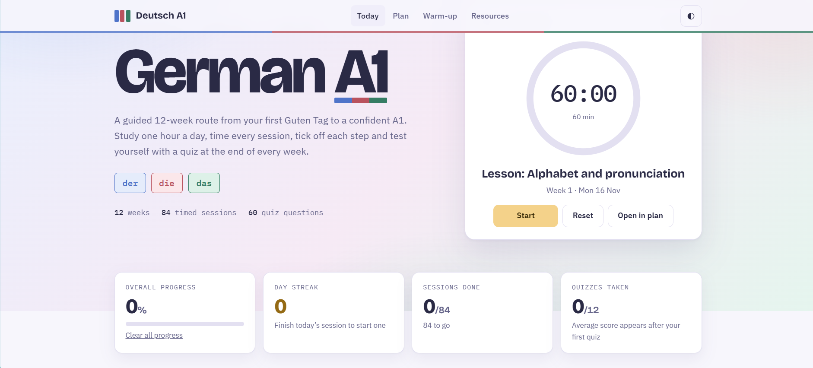
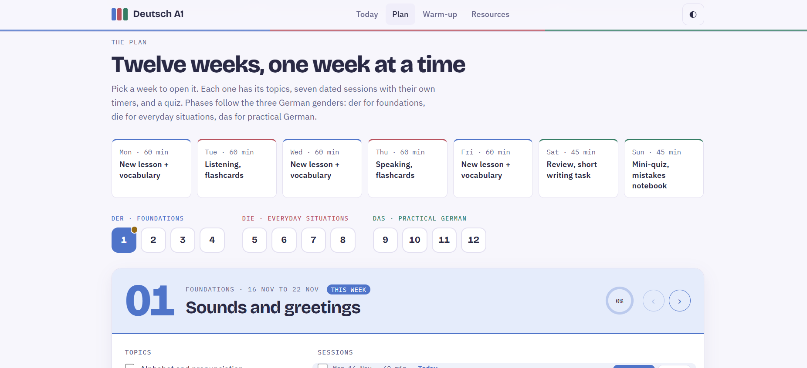
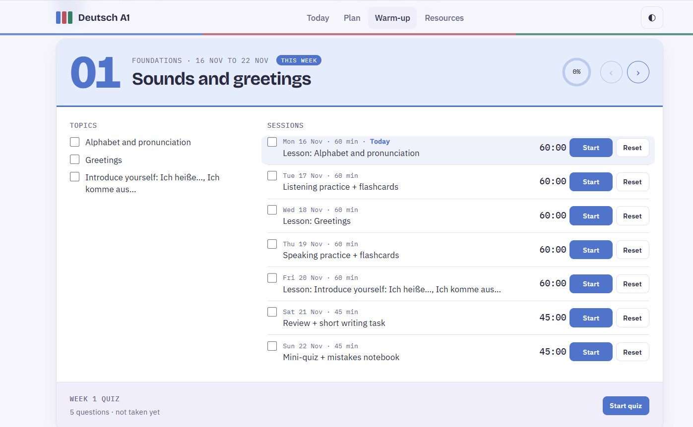
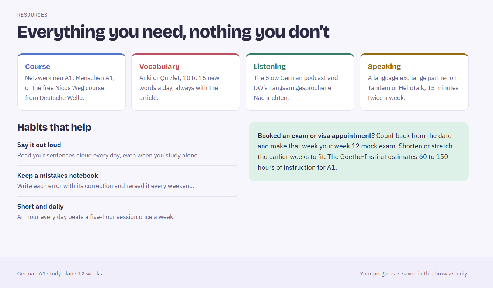

# German A1 Study Plan

A 12-week plan to reach German A1, built as a static website. Study one hour a day, time each session, tick off every step and test yourself with a quiz at the end of each week.

[](https://mein-deutsch-plan.vercel.app/)

## Screenshots

**Home: today's session, focus timer and progress tiles**



**Plan: weekly rhythm and the 12-week navigator, grouped by phase**



**Week view: topics, seven dated sessions with timers, and the weekly quiz**



**Resources and habits**



## What's inside

- **12-week plan** in three phases: Foundations, Everyday situations, Practical German
- **84 timed sessions** (60 minutes on weekdays, 45 on weekends) with a countdown and a sound when time is up
- **Today's session** panel that shows what to study right now
- **12 weekly quizzes** with instant feedback and explanations (60 questions)
- **Der, die or das?** warm-up game to practise noun articles
- **Progress tracking** for overall progress, day streak, sessions and quiz scores
- **Light and dark theme**, responsive on phone and desktop

Your progress is saved in your own browser (`localStorage`). Nothing is sent anywhere, so it does not sync between devices.

## Study plan at a glance

| Weeks | Phase | Focus |
| --- | --- | --- |
| 1 to 4 | Foundations | Sounds, greetings, numbers, time, first sentences, articles and nouns |
| 5 to 8 | Everyday situations | People, food and shopping, accusative, negation, daily routine |
| 9 to 12 | Practical German | Directions, housing, appointments, Perfekt, forms, mock exam |

Weekly rhythm:

| Day | Session |
| --- | --- |
| Day 1, 3, 5 | New lesson and vocabulary (60 min) |
| Day 2, 4 | Listening or speaking and flashcards (60 min) |
| Day 6 | Review and a short writing task (45 min) |
| Day 7 | Mini-quiz and mistakes notebook (45 min) |

## Run it locally

No build step and no dependencies. Open `index.html` in a browser, or serve the folder:

```bash
python3 -m http.server 8000
```

Then visit `http://localhost:8000`.

## Deploy with GitHub Pages

1. Push this repo to GitHub.
2. Go to **Settings → Pages**.
3. Under **Build and deployment**, choose **Deploy from a branch**.
4. Select your main branch and the `/ (root)` folder, then save.
5. After a minute the site is live at `https://<your-username>.github.io/german-a1-study-plan/`.

## Repository structure

```
german-a1-study-plan/
├── index.html          # the website (plan, timers, quizzes, warm-up game)
├── README.md
├── screenshots/        # images used in this README
├── flashcards/         # vocabulary decks (planned)
├── cheatsheets/        # one-page grammar and vocabulary summaries (planned)
├── resume/             # CV and cover letter in German (planned)
└── resources/          # PDFs, audio and links you collect (planned)
```

### Suggested contents for the planned folders

- **`flashcards/`**: one file per week or topic, for example `week-01-greetings.csv` with columns `front,back`. CSV files import straight into Anki and Quizlet. Always write nouns with their article (`der Tisch`).
- **`cheatsheets/`**: short Markdown files such as `articles.md`, `verb-conjugation.md`, `numbers-and-time.md`, `question-words.md`, `separable-verbs.md` and `perfekt.md`.
- **`resume/`**: your Lebenslauf (German CV) and a Anschreiben (cover letter) template, as `lebenslauf.md` and `anschreiben.md`.
- **`resources/`**: official sample exams, listening files and notes from your course.

## Customizing the plan

All content lives in `index.html`:

- **Weeks and topics:** the `PHASES` array in the script.
- **Quiz questions:** the `QUIZ` object, one list of five questions per week.
- **Warm-up nouns:** the `NOUNS` array.
- **Start date:** the `START` constant (a `Date` for the Monday of week 1). The week dates inside the page are derived from it.
- **Colors and fonts:** the design tokens at the top of the `<style>` block, in `:root`. Dark mode values are in the two dark blocks right below.

## Resources

- Course books: *Netzwerk neu A1*, *Menschen A1*
- Free course: Deutsche Welle, *Nicos Weg*
- Listening: Slow German podcast, DW *Langsam gesprochene Nachrichten*
- Vocabulary: Anki or Quizlet
- Speaking practice: Tandem or HelloTalk

The Goethe-Institut estimates 60 to 150 hours of instruction for A1.

## Roadmap

- [ ] Add flashcard decks for each week
- [ ] Add grammar and vocabulary cheat sheets
- [ ] Add German CV and cover letter templates
- [ ] Add links to flashcards and cheat sheets from each week of the plan
- [ ] Add a mock A1 exam for week 12

## Author

**Ons Ajmi**
Cloud Infrastructure Management Engineering student at TEK-UP University, Tunisia.

- GitHub: [AjmiOns](https://github.com/AjmiOns)
- LinkedIn: [Ons Ajmi](https://www.linkedin.com/in/ons-ajmi--/)

## License

Personal learning project.
